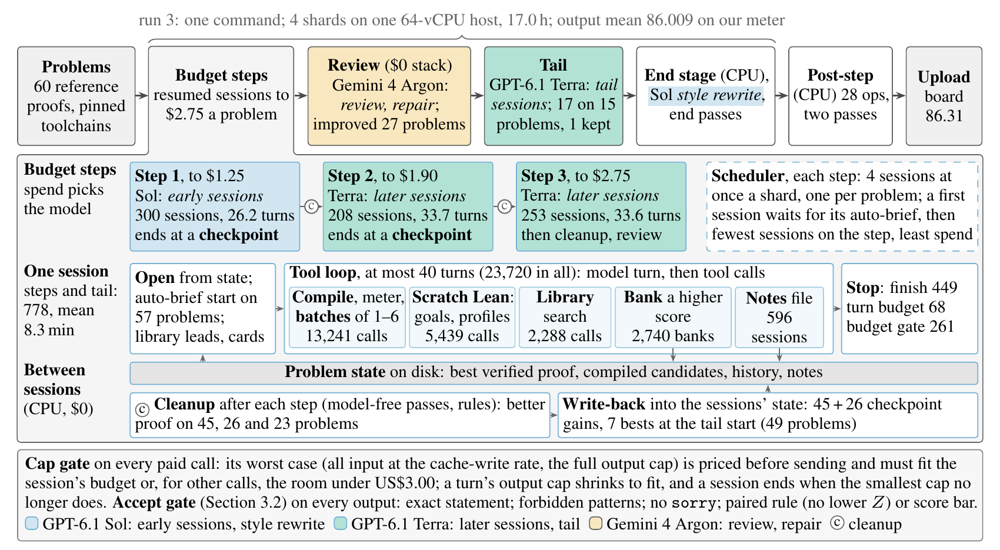

# Lean Refactor Arena: closed-source LLM track (team Vexorium)

This is our entry (username `Vexorium-Agent`) in the closed-source LLM track of the
[Lean Refactor Arena](https://huggingface.co/spaces/delta-lab-ai/lean-refactor-arena), a NeurIPS 2026 VERICODEGEN workshop
competition. The task is to rewrite each benchmark problem's Lean proof so that it is shorter and cheaper to check, while it still
compiles on every listed toolchain.

Every problem starts from its seed proof. GPT-6.1 Sol and then GPT-6.1 Terra (through OpenRouter) refactor it in budget steps of
resumed, tool-using sessions. Gemini 4 Argon reviews the result, and model-free CPU stages make mechanical rewrites between the steps
and at the end. A model-free post-step then runs on the output. Every paid call is priced at its worst case before it is sent, so no
problem spends more than US$3.00.

**Final result:** upload `sub41`, leaderboard score **86.31** (L 77.07, H 81.86, Z 100), eighth on the closed-track leaderboard at the
deadline (2026-11-04 11:59 UTC). The upload carries no `set_option` of any kind.



*Figure 1 (from our report): the closed pipeline (run 3 and the upload), budget steps opened up. Counts: run 3's totals over the 60
problems; turns: means per session; budget steps: cumulative spend per problem at list prices. A checkpoint ends steps 1 and 2 once a
shard's problems all reach the step's top: cleanup, write-back, go on or stop (stopped: 1 after step 1, no headroom; 0 after step 2).
Not drawn: a $0 crossover before the review (adopted on 0).*

- **Report:** [OpenReview](https://openreview.net/forum?id=0vGRIeVAFB).
- **Code of the final upload:** tag
  [`closed-final-sub41-20261104`](https://github.com/bobbercheng/lean-refactor-closed/tree/closed-final-sub41-20261104).
- **Results and all uploads:** [`RESULTS.md`](RESULTS.md). **Disclosures:** [`DISCLOSURES.md`](DISCLOSURES.md).

## Run it on the full benchmark (60 problems)

The final upload's package is the `final/` folder of the tag `closed-final-sub41-20261104`. On `main`, [`final/`](final/README.md) is
the same run's code without the post-step.

**What you need**

- Linux (x86-64 or aarch64) with systemd user units (`loginctl enable-linger $USER`), and Docker with your user in the `docker` group.
- At least 16 vCPU and 64 GB RAM; we ran on 64 vCPU and 256 GB. About 250 GB of free disk for the Lean environments of 60 problems,
  plus about 20 GB for the run.
- git, curl, ripgrep, zstd, and Python 3.11 or newer with `requests`.
- Network access to GitHub, Docker Hub and openrouter.ai.
- One OpenRouter API key with at least $3.00 x problems of credit ($180 for 60), able to call `openai/gpt-6.1-sol`,
  `openai/gpt-6.1-terra` and `google/gemini-4-argon`. No other credential is needed, and none is included.
- The final benchmark's rows file (60 rows, sha256 `d53690b057f9972f44643678ee6b5eee7a66f56e1a7d2678a2e5ff47fadbd682`). It is not in this
  repository.

**One file is withheld.** The style rewrite's example file `harness/style_rw_exemplars.json` is not in this repository. The organizers
have it in our submitted code ZIP. Without it, the run refuses at start, before any model call. Setting `STYLE_RW_ARGS = ()` in
`infra/closed_package/run_final.py` runs the rest of the pipeline without that step, but that is not the pipeline of our official run.

**Commands**

```bash
# The package must be the root of its own git checkout.
git clone --branch closed-final-sub41-20261104 https://github.com/bobbercheng/lean-refactor-closed.git lra-closed
mkdir ~/lra && cp -a lra-closed/final/. ~/lra/ && cd ~/lra
git init -q && git add -A && git -c user.name=lra -c user.email=lra commit -qm "closed final package"
git config extensions.worktreeConfig true
ROWS=/path/to/final_rows.jsonl     # the 60 rows, as an absolute path

# Install (once per host): the Lean environments the rows pin, and the session container image.
infra/closed_package/install_envs.sh "$ROWS" && infra/closed_package/build_image.sh
# Reference heartbeats, with the env fix.
mkdir -p ~/lra-in && python3 infra/refhb/make_ref_heartbeats.py --rows "$ROWS" --out ~/lra-in/heartbeats.jsonl --jobs 8

# The run: about 17 h for 60 problems on 64 vCPU, at most $3.00 a problem. Run it in tmux.
export OPENROUTER_API_KEY=...
python3 infra/closed_package/run_final.py run --rows "$ROWS" --heartbeats ~/lra-in/heartbeats.jsonl --out ~/lra-final \
  --bets D2,D3,D4,D4P,D4S,D4C,D4N

# The post-step: two passes, CPU only, $0, about 23 min each on 64 vCPU.
OPS4=implied,closerprep,inlineeq,hintgrind,projpath,lexsurf,jointres,t4ind,ctorsearch,argon_funind,argon_hbelab,argon_hpcert,sonnet_listdrop,sonnet_lintdrop,opus_hoist,opus_stepdrop,opus_rundrop,opus_scaffold,opus_armfold,opus_goalmerge,opus_patfuse,sonnet_surface,sol_harvest,v4_unhyg,hb_hotctl,v4_patelide,v4_rescreen,hb_hotelab
python3 infra/closed_package/post_step.py --out ~/lra-final --compile-slots 56 --ops "$OPS4"
python3 infra/closed_package/post_step.py --out ~/lra-final --compile-slots 56 --ops "$OPS4" \
  --input ~/lra-final/post_step/proofs.post.jsonl --post-dir ~/lra-final/post_step2

# Check the file to upload.
python3 harness/final_merge.py --rows "$ROWS" --check ~/lra-final/submission.post.jsonl
```

- **The file to upload** is `~/lra-final/submission.post.jsonl`: one `{"name", "proof"}` line per problem, in the rows file's order.
- **Cost.** Our run 3 spent $166.33 for the 60 problems as reported ($173.97 at the cap's price; at most $2.969 on any problem). The cap
  is enforced in code, and a problem's spend survives a crash or restart. A rerun gives other proofs, because the models sample.
- **More detail.** That tag's
  [`final/REPLICATE.md`](https://github.com/bobbercheng/lean-refactor-closed/blob/closed-final-sub41-20261104/final/REPLICATE.md) gives
  every step with its expected output, wall time and cost, and how our run compares.
  [`final/README.md`](https://github.com/bobbercheng/lean-refactor-closed/blob/closed-final-sub41-20261104/final/README.md) covers the
  pipeline, every setting, resuming after a crash, a $0 dry run with a fake model (it also needs the withheld file), and the post-step.
- **Safety.** The final package runs the model's tool-using sessions in a container. The code in `warmup/` does not: its `shell` tool
  is guarded by a deny-list only, so it is **not a sandbox**. Before you run that code, move `warmup/submit/candidates/`,
  `warmup/submit/results/` and the recorded runs and snapshots out of reach of the account that runs the model, and give that account
  nothing except its one API key ([`warmup/README.md`](warmup/README.md) section 7.2). Create your own key files at the paths in its
  section 9.

## Documents

| Document | What it holds |
|---|---|
| [`RESULTS.md`](RESULTS.md) | the final upload and its code ZIP hash, every closed-track upload (warm-up and final benchmark), our warm-up pipelines (91.70 from the seed proofs, the first submission at 89.46, the clean pipeline at 90.69), and what each folder holds |
| [`DISCLOSURES.md`](DISCLOSURES.md) | the kernel skip in `sub30` and `sub32` (withdrawn after them); what the final package carries from our development work, including end-stage passes developed on the final benchmark; the knowledge given to the first warm-up submission |
| [`final/README.md`](final/README.md) | the package on `main` (closed run 3's code without the post-step): requirements, install, the run command, outputs, wall time and cost, resume, a $0 dry run, and our three official runs |
| [`final/CODE_VERSION.md`](final/CODE_VERSION.md) | the exported commit and every edit made at export |
| [`warmup/README.md`](warmup/README.md) | the first warm-up submission: result, model and harness, budget-ladder protocol, timeline, knowledge provenance, setup, and the commands to re-verify and replicate it |
| [`warmup/BUDGET.md`](warmup/BUDGET.md), [`warmup/CODE_VERSIONS.md`](warmup/CODE_VERSIONS.md) | that submission's per-problem API spend, and the code version of each round |
| [`warmup/AUTOBRIEF.md`](warmup/AUTOBRIEF.md), [`warmup/POSTPASS.md`](warmup/POSTPASS.md) | the clean pipeline from the seed proofs (90.69), and the CPU post-passes |
| [`NOTICE.md`](NOTICE.md) | third-party material and its terms, and the edits made for public release |
| [Report](https://openreview.net/forum?id=0vGRIeVAFB) | our technical report on OpenReview |

## License

Our code, notes and run records are licensed under the [PolyForm Noncommercial License 1.0.0](LICENSE): free for study,
research and other noncommercial use. **Commercial use needs a separate license**: contact b.cheng@vexorium.net. Third-party
material (upstream Lean library sources, competition data, model outputs) keeps its own terms; see [`NOTICE.md`](NOTICE.md),
which also lists the edits made for public release.
